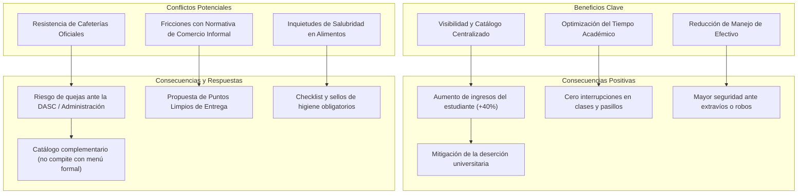
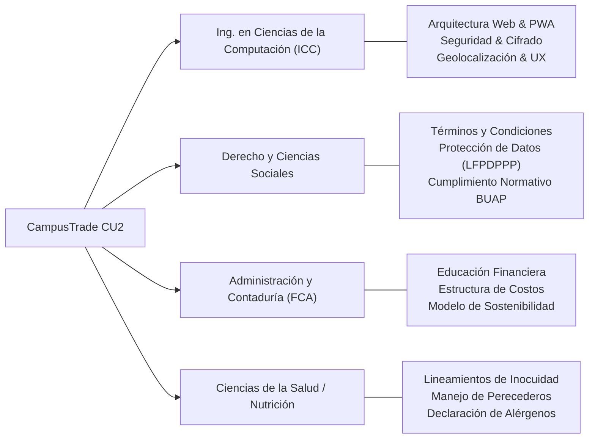

# PROYECTO DE INNOVACIÓN: "CampusTrade CU2"
## Plataforma Digital de Economía Colaborativa y Microemprendimiento para la Comunidad BUAP CU2

---

### Ficha Técnica del Proyecto
- **Carrera:** Ingeniería en Ciencias de la Computación (ICC)
- **Institución:** Benemérita Universidad Autónoma de Puebla (BUAP)
- **Sede:** Complejo Universitario CU2 (Ecocampus Valsequillo)
- **Nombre de la Innovación:** CampusTrade CU2 ("LoboTrade")
- **Tipo de Proyecto:** Aplicación Web Progresiva (PWA / Mobile-First) con Geolocalización de Campus

---

## 1. Planteamiento del Problema y Justificación
En el contexto universitario de la BUAP —particularmente en el nuevo campus **CU2**, caracterizado por su extensión territorial, distribución en múltiples edificios multidisciplinarios (EMA 1-11, VAL 1-5, FCQ, FCE, CCS, Ingenierías) y una considerable distancia de la mancha urbana de Puebla—, los estudiantes enfrentan dos realidades cotidianas:
1. **Necesidad de ingresos económicos:** Cientos de alumnos solventan gastos diarios (transporte del Sistema de Transporte Universitario STU, materiales de laboratorio, alimentos y libros) mediante la venta informal de dulces, postres caseros, snacks, papelería y accesorios tecnológicos.
2. **Ineficiencia en la dinámica tradicional de venta:** Actualmente, el estudiante vendedor debe recorrer pasillo por pasillo o esperar a que alguien pregunte en grupos de WhatsApp o Facebook no estructurados, lo cual distrae el tiempo de estudio, satura chats académicos, expone la mercancía y genera transacciones caóticas en efectivo.

**CampusTrade CU2** nace de la Ingeniería en Ciencias de la Computación como una **innovación tecnológica y social** que transforma el comercio informal en una red colaborativa segura, georreferenciada y regulada.

---

## 2. Objetivo General y Objetivos Específicos

### Objetivo General
Desarrollar e implementar una plataforma web interactiva y aplicación progresiva (PWA) centralizada que conecte a estudiantes emprendedores con la comunidad universitaria del campus BUAP CU2, facilitando la gestión de catálogos digitales en tiempo real, geolocalización por edificios y áreas comunes, recepción de pedidos programados y acuerdos de entrega en zonas seguras, promoviendo la inclusión financiera y la retención escolar.

### Objetivos Específicos
1. **Digitalizar la oferta estudiantil:** Proveer a los estudiantes emprendedores un micro-panel de vendedor (*LoboEmprende*) para publicar productos con inventario, fotos, precios y estado en vivo (ej. *"En clase en EMA 3 hasta las 14:00 hrs"*).
2. **Georreferenciar puntos de entrega segura en CU2:** Incorporar un mapa interactivo del campus CU2 que delimite "Puntos Limpios de Entrega" (Nodo de Transferencia STU, Explanada EMA 3 Cómputo, Centro de Convivencia CCS1, explanadas VAL) para no interferir con las clases ni con las cafeterías.
3. **Facilitar pagos digitales y trazabilidad:** Integrar pasarelas ligeras de pago (transferencias CoDi, SPEI y pagos QR) que disminuyan la portación de dinero en efectivo en el transporte público y pasillos.
4. **Garantizar el cumplimiento ético y regulatorio:** Establecer filtros algorítmicos contra fraude escolar (venta de tareas) y sustancias prohibidas, alineados al Estatuto Orgánico y Reglamentos de la BUAP.

---

## 3. Beneficios y Conflictos (con sus Consecuencias Directas)

### Tabla Comparativa Detallada

| Dimensión | Factor | Descripción | Consecuencia Directa | Solución Implementada en CampusTrade |
| :--- | :--- | :--- | :--- | :--- |
| **Beneficio** | **Visibilidad y Alcance** | El catálogo del alumno no depende de quién camine frente a él; llega a todo CU2 al instante. | Multiplicación de la rotación de inventario y previsión de demanda antes de salir de casa. | Motor de búsqueda, categorización y vista en tiempo real de vendedores activos. |
| **Beneficio** | **Optimización del Tiempo** | Pedidos programados con anticipación para entregar justo en los 10 minutos de cambio de clase. | Cero pérdidas de asistencia a clases y mayor concentración académica tanto de vendedor como de comprador. | Selector de horarios y puntos de entrega programada (*Pick-up express*). |
| **Beneficio** | **Digitalización de Pagos** | Aceptación de transferencias electrónicas bancarias (SPEI/CoDi/apps móviles). | Disminución drástica del riesgo de asaltos o pérdidas de efectivo en los trayectos del STU. | Generación de comprobante digital y confirmación mutua en la plataforma. |
| **Conflicto** | **Conflicto con Concesiones de Alimentos** | Cafeterías institucionales pueden alegar competencia desleal o pérdida de clientes en el campus. | Intentos de prohibición de ventas estudiantiles o quejas ante las autoridades universitarias. | Enfoque en micro-snacks, botanas artesanales, artículos de emergencia y papelería; entregas discretas en puntos autorizados. |
| **Conflicto** | **Regulación del Espacio Universitario** | Directiva del campus preocupada por desorden, basura o comercio ambulante descontrolado. | Posibles amonestaciones de seguridad institucional o decomiso de canastas/mochilas a los estudiantes. | Creación del concepto de **"Puntos Limpios"** acordados y compromiso de cero venta dentro de las aulas. |
| **Conflicto** | **Inocuidad y Salubridad** | Riesgo de intoxicación por comida elaborada sin medidas higiénicas o de dudosa procedencia. | Deterioro de la salud de los alumnos y desprestigio del comercio estudiantil. | Protocolo de higiene obligatorio, declaración de alérgenos y sistema de reputación/reseñas comunitarias verificadas. |

---

## 4. Impacto Multidimensional

### A. Impacto Tecnológico
- **Arquitectura Web Moderna:** Implementación de una Progressive Web App (PWA) ligera con estándares HTML5, CSS3, Tailwind CSS y JavaScript reactivo, permitiendo su instalación instantánea en dispositivos Android e iOS sin depender de descargas pesadas en tiendas de aplicaciones.
- **Resiliencia ante Conectividad Limitada:** Considerando que CU2 está en fase de despliegue de infraestructura de telecomunicaciones, la app almacena catálogos en caché local (`LocalStorage` e `IndexedDB`), funcionando incluso con variaciones de señal celular.
- **Georreferenciación Esquemática:** Digitalización del mapa oficial de CU2 con identificación interactiva de nodos (EMA 1 a EMA 11, VAL 1 a 5, FCQ1, FCE1, CCS1, Nodos STU).

### B. Impacto Económico
- **Retención del Capital en la Comunidad Estudiantil:** Cada peso gastado en CampusTrade queda en manos de otro estudiante que lo reinvierte en su transporte STU, copias, alimentos o pago de colegiaturas.
- **Economía Circular y Microemprendimiento:** Capacita a los alumnos en habilidades de comercio electrónico, gestión de inventario, pricing y servicio al cliente desde la universidad.

### C. Impacto Social y Comunitario
- **Solidaridad Universitaria ("Lobos apoyando a Lobos"):** Fortalece el sentido de pertenencia y ayuda mutua en un campus de nueva creación donde la comunidad está forjando sus lazos.
- **Reducción de Brechas:** Dignifica el trabajo del estudiante que debe laborar para costearse la carrera, eliminando el estigma del "vendedor de pasillo".

---

## 5. Trabajo Interdisciplinario

El éxito de CampusTrade requiere la concurrencia de distintas disciplinas universitarias impartidas en la BUAP:

1. **Ingeniería en Ciencias de la Computación (Líder Técnico):**
   - Diseño del software, desarrollo frontend responsivo, bases de datos no estructuradas/relacionales, API de geolocalización, ciberseguridad, testing y mantenimiento continuo.
2. **Derecho (Facultad de Derecho y Ciencias Sociales):**
   - Asesoría jurídica en la redacción de Términos del Servicio y Política de Privacidad bajo la Ley Federal de Protección de Datos Personales en Posesión de los Particulares (LFPDPPP).
   - Delimitación del papel de la plataforma como intermediario neutral de software sin relación laboral con los estudiantes.
   - Compatibilidad con el Reglamento Interior de Alumnos y el Estatuto Orgánico de la BUAP.
3. **Administración de Empresas y Contaduría (Facultad de Contaduría Pública):**
   - Incorporación de módulos didácticos de educación financiera: cálculo del costo unitario, margen de ganancia real y control de mermas.
   - Definición del modelo de sostenibilidad de la plataforma (acceso 100% gratuito para estudiantes, con posible patrocinio de egresados o microservicios premium de visibilidad destacada).
4. **Ciencias de la Salud / Nutrición (Complejo de la Salud / CCS1):**
   - Establecimiento de lineamientos claros sobre conservación de temperaturas (bebidas frías, postres que requieren refrigeración), uso de empaques individuales y advertencia de ingredientes alergénicos (cacahuate, gluten, lácteos).

---

## 6. Retribución Social: Combate a la Deserción Universitaria

La deserción escolar en facultades de ingeniería en México tiene un componente económico crítico: gastos no previstos de transporte diario hacia CU2, comidas y consumibles escolares orillan a muchos estudiantes a abandonar los estudios o retrasar materias.
- **CampusTrade CU2** ofrece una vía digna, flexible y compatible con los horarios académicos para generar liquidez inmediata.
- El estudiante no tiene que ausentarse de la universidad para trabajar en un empleo formal de 8 horas con horarios rígidos; puede autofinanciarse dentro de su mismo horario universitario.

---

## 7. Elementos Éticos y Regulaciones

### A. Elementos Éticos
1. **Privacidad y No Comercialización:** La plataforma asume el compromiso ético absoluto de no recopilar datos biométricos, no comercializar correos institucionales `@alumno.buap.mx` ni rastrear ubicaciones en segundo plano cuando la app está cerrada.
2. **Transparencia y Moderación sin Toxicidad:** El sistema de calificaciones y comentarios cuenta con filtros contra el acoso, calumnias o discriminación de género/facultad, fomentando reseñas constructivas sobre la puntualidad y calidad del producto.
3. **Equidad y Oportunidad:** Ningún vendedor recibe favoritismos injustos; el algoritmo de descubrimiento prioriza la cercanía geográfica y la disponibilidad inmediata para que todos los emprendedores tengan visibilidad equitativa.

### B. Regulaciones y Marco Jurídico Aplicable
1. **Protección de Datos Personales (LFPDPPP):**
   - Implementación de un **Aviso de Privacidad Integral** accesible antes del registro.
   - Ejercicio garantizado de los derechos ARCO (Acceso, Rectificación, Cancelación y Oposición) con eliminación inmediata de perfiles y productos a petición del usuario.
2. **Reglamento Universitario BUAP:**
   - **Cero Tolerancia al Fraude Escolar:** Filtros semánticos y reglas de negocio para prohibir tajantemente la oferta de tareas escolares, ensayos, exámenes resueltos o elaboración de tesis. La infracción amerita baja inmediata de la plataforma y reporte institucional.
   - **Prohibición de Sustancias y Artículos Ilegales:** Queda estrictamente vetada la venta de bebidas alcohólicas, cigarros tradicionales o electrónicos (vapes), medicamentos controlados y cualquier sustancia no permitida en instalaciones escolares.
3. **Protocolos de Salubridad e Inocuidad:**
   - Requisito de aceptación de la *Guía de Buenas Prácticas de Manipulación de Alimentos* al registrar productos comestibles: uso obligatorio de bolsas selladas, guantes/pinzas para servir y fecha de elaboración visible.
