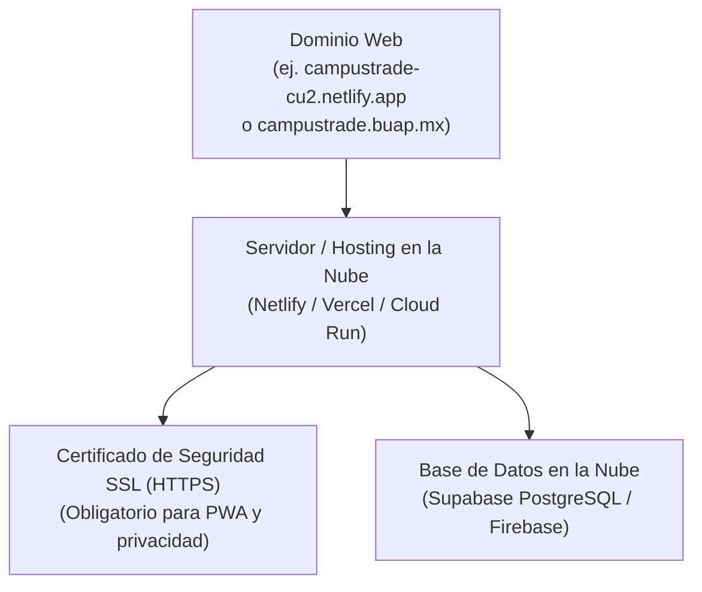

# GUÍA DE REQUISITOS Y PUBLICACIÓN DEL SITIO WEB EN LA NUBE
## Proyecto de Innovación "LoboTrade CU2" (BUAP)

---

### ¿Por qué este proyecto ya no es solo un archivo HTML suelto?
Hemos transformado el proyecto en una **plataforma web completa** con:
1. **Un Servidor Web dedicado (`server.js` y `start-server.bat`):** Ya corre como un servidor HTTP real en el puerto 3000, permitiendo acceso tanto en tu computadora (`http://localhost:3000`) como en celulares conectados a la misma red Wi-Fi universitaria o de tu casa (`http://192.168.X.X:3000`).
2. **Un Sistema de Autenticación y Almacenamiento Seguro (`js/store.js`):** Valida cuentas de estudiantes con correo institucional `@alm.buap.mx`, contraseñas cifradas y sesiones privadas.
3. **Un Portal Apartado y Exclusivo de Vendedores (`portal-vendedor.html`):** Los vendedores tienen su propio entorno protegido donde solo ellos pueden ver y administrar sus pedidos, inventario, ventas y datos sensibles.
4. **Cero Datos de Prueba:** El catálogo inicia en estado de producción real. Los productos que se muestran son exclusivamente los creados por vendedores registrados.
5. **Configuración de Despliegue en la Nube (`netlify.toml`):** Listo para publicarse en internet con un solo clic.

---

## 📋 Requisitos para tener el Sitio Web en Línea (Internet Público)

Para que cualquier estudiante en CU2 pueda entrar desde sus datos móviles (4G/5G) sin depender de tu computadora encendida, se requieren 4 elementos estándar en la industria del software:

### 1. Hosting / Servidor Web en la Nube (Gratuito)
Es la computadora remota en internet que mantendrá tu página activa las 24 horas del día.
* **Opción Recomendada 1: Netlify (100% Gratuito):**
  * Incluye certificado SSL (HTTPS) automático.
  * No requiere tarjeta de crédito.
  * Te entrega una dirección pública como `https://campustrade-cu2.netlify.app`.
  * Ya dejamos configurado el archivo `netlify.toml` en tu proyecto.
* **Opción Recomendada 2: Vercel (100% Gratuito):**
  * Despliegue instantáneo conectando tu repositorio de GitHub.
* **Opción 3: GitHub Pages (100% Gratuito):**
  * Aloja la web directamente desde tu repositorio de GitHub `https://tu-usuario.github.io/tu-repo/`.

### 2. Nombre de Dominio (Dirección Web)
* **Gratuito:** Puedes usar el subdominio que te otorga Netlify o Vercel (`*.netlify.app` o `*.vercel.app`).
* **Institucional (Académico):** Puedes solicitar a la Dirección de Administración Escolar (DAE) o a la Dirección de Apoyo y Seguridad Universitaria (DASU / DASC BUAP) un subdominio institucional como `campustrade.buap.mx` o `cu2.buap.mx/campustrade`.
* **Personalizado Comercial:** Puedes registrar un dominio `.com` o `.mx` en plataformas como Namecheap, Cloudflare o Hostinger (costo aproximado de \$150 a \$250 pesos mexicanos al año).

### 3. Certificado de Seguridad SSL / HTTPS (Obligatorio)
Por regulaciones de la Ley Federal de Protección de Datos Personales en Posesión de los Particulares (LFPDPPP) y porque la aplicación es una PWA que se instala en celulares, la conexión debe ser **HTTPS** cifrada para que nadie pueda interceptar contraseñas ni números de WhatsApp. Tanto Netlify como Vercel y Cloudflare lo integran de manera gratuita mediante *Let's Encrypt*.

### 4. Base de Datos en Producción (Backend Escalable)
Actualmente, el sistema cuenta con la capa de datos modular en `js/store.js` que gestiona usuarios, contraseñas, inventario y pedidos con persistencia en el navegador del cliente. Para centralizar los datos en internet en un entorno multi-dispositivo masivo, las opciones recomendadas para un estudiante de Ciencias de la Computación son:
* **Supabase (PostgreSQL en la nube):** Otorga un nivel gratuito ideal con base de datos relacional, autenticación y políticas *Row Level Security (RLS)* para garantizar que ningún vendedor pueda ver pedidos de otro.
* **Firebase Firestore (Google Cloud):** Base de datos NoSQL en tiempo real con sincronización automática de pedidos.

---

## 🚀 Cómo Publicar tu Sitio Web en Internet en 3 Pasos (Gratis)

### Método Fácil con Netlify Drop (Sin comandos):
1. Entra a [https://app.netlify.com/drop](https://app.netlify.com/drop).
2. Arrastra la carpeta completa `AntigravityCodeGem` sobre la ventana de tu navegador.
3. ¡Listo! En menos de 30 segundos Netlify te otorgará tu enlace web público HTTPS (ejemplo: `https://campustrade-cu2.netlify.app`) que podrás compartir con tus profesores y compañeros de CU2.

### Cómo ejecutarlo localmente en tu computadora:
1. Haz doble clic en el archivo [start-server.bat](file:///c:/Users/javie/Documents/AntigravityCodeGem/start-server.bat).
2. Se abrirá la terminal indicándote:
   * **URL local:** `http://localhost:3000`
   * **URL para tu celular (misma red Wi-Fi):** `http://[TU_IP]:3000`
   * **Portal de Vendedores:** `http://localhost:3000/portal-vendedor.html`
